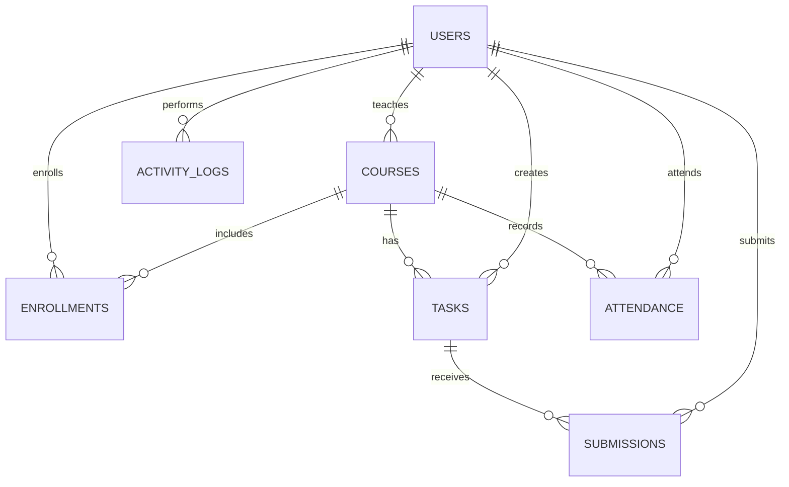

# Database design

`database/schema.sql` creates seven InnoDB tables in `taskmate_db` without dropping existing records. MySQL 8 is required for enforced CHECK constraints.

`users` stores one account per email and a constrained role. A course stores its assigned faculty and section/year. The `enrollments` bridge provides a many-to-many student-course relationship. `tasks` represent assignments, quizzes, and assessments. One submission per task/student stores pending/submitted/evaluated state; marks remain nullable until evaluation. Attendance is unique per student/course/date. Activity logs identify the actor and affected entity.

Indexes support role dashboards, due-date sorting, course/section lookup, student pending work, and activity history. Overdue is intentionally calculated from `due_date`, current date, and submission state, not stored.
